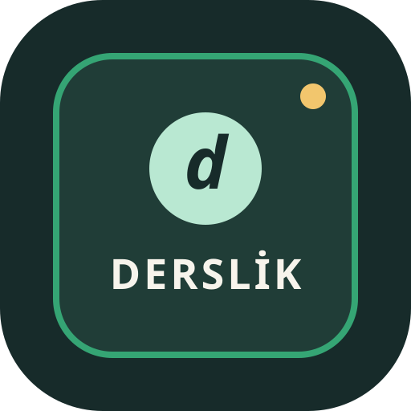

<div align="center">

  

  # ✦ lifeHub (Derslik) ✦
  ### *Minimalist Weekly Planner, Sticky Notebook & Pomodoro Focus Timer*

  [](https://mertssari.github.io/lifeHub/)
  [](https://mertssari.github.io/lifeHub/)
  [](https://firebase.google.com/)
  [](LICENSE)

  <p align="center">
    <b>A modern, distraction-free productivity dashboard built for students, developers, and creators.</b><br>
    Plan your week, take sticky notes, boost focus with Pomodoro, and seamlessly sync in real-time across your PC and mobile devices.
  </p>

  <p align="center">
    <a href="#-key-features">Key Features</a> •
    <a href="#-live-demo">Live Demo</a> •
    <a href="#-mobile-experience-pwa">Mobile PWA</a> •
    <a href="#-cloud-sync-architecture">Cloud Sync</a> •
    <a href="#-tech-stack">Tech Stack</a> •
    <a href="#-getting-started">Getting Started</a>
  </p>

  ---

</div>

## 🌟 Overview

**lifeHub** is a privacy-conscious, client-side progressive web application designed to bring order to your daily routine. Unlike overly complex productivity tools, lifeHub combines the three most essential elements of staying productive into a unified, beautiful workspace:

1. **📅 Weekly Schedule & Daily Planner** with native Drag & Drop.
2. **📝 Interactive Sticky Notes & Idea Board** with color-coding and pinning.
3. **⏱️ Circular Pomodoro Focus Timer** with zero-latency synthesized audio notifications.
4. **☁️ Zero-Setup Realtime Cloud Sync** powered by Google Authentication & Firebase Firestore.

---

## ✨ Key Features

### 📅 1. Weekly & Daily Task Planner
- **Drag & Drop Organization:** Effortlessly reschedule tasks across days with desktop drag & drop or quick mobile day-switchers.
- **Task Prioritization & Categorization:** Tag tasks by difficulty (*Easy, Medium, Hard*) and category (*📚 Study, ✏️ Homework, ✅ Task, 🎯 Exam*).
- **Instant Checklist Toggle:** Complete tasks with a single click right on the card.
- **Dynamic Weekly Progress Meter:** Real-time completion percentage and progress bar.

### 📝 2. Freeform Sticky Notebook
- **Color-Coded Canvas:** Organize thoughts with pastel tones (*Mint, Sunflower Yellow, Coral, Lavender, Warm Paper*).
- **Pin Important Notes:** Keep priority reminders pinned to the very top.
- **Instant Fuzzy Search:** Search across all note titles and contents with zero lag.

### ⏱️ 3. Pomodoro Focus Timer
- **Customizable Intervals:** 25-minute Deep Work, 5-minute Short Break, and 15-minute Long Break presets.
- **Task Association:** Link active study sessions directly to tasks on your agenda.
- **Synthesized Audio Chimes:** Built with the browser's native **Web Audio API** — no heavy external sound files required!
- **Session Tracker:** Count your daily completed tomato sessions.

### ☁️ 4. Real-Time Cross-Device Sync
- **Google Sign-In:** One-click authentication with your Google account.
- **Instant Cloud Sync:** Add or complete a task on your phone, and watch it appear **in real-time on your computer screen** via Firestore listeners.
- **Offline First:** Fully functional without an internet connection using local cache fallback.

### ⇄ 5. Data Ownership & Portability
- **JSON Export / Import:** Download a complete snapshot of your data at any time.
- **Clipboard Migration:** Quick-copy raw data to send via WhatsApp, Telegram, or email.

---

## 📱 Mobile Experience (Progressive Web App)

lifeHub is engineered **mobile-first**:

| Feature | Desktop | Mobile (iOS / Android) |
|---|---|---|
| **Navigation** | Sticky top bar pill tabs | Ergonomic bottom navigation bar |
| **Schedule View** | 7-column calendar grid | Horizontal swipeable day chips |
| **Task Movement** | Native HTML5 Drag & Drop | One-tap Day Switch dropdown |
| **Offline Mode** | Fully cached with Service Worker | Installable as a standalone app icon |
| **Display Mode** | Browser window | Edge-to-edge standalone (No URL bar) |

### 📲 How to Install as an App:
- **iOS (Safari):** Open [https://mertssari.github.io/lifeHub/](https://mertssari.github.io/lifeHub/) → Tap **Share** (square with arrow) → Select **"Add to Home Screen"**.
- **Android (Chrome):** Open the link → Tap the **Three Dots (⋮)** → Select **"Install App"** or **"Add to Home screen"**.

---

## 🛠️ Tech Stack

```
Frontend:            HTML5, Modern CSS3 (CSS Variables, Flexbox, Grid), Vanilla JavaScript (ES6+)
Cloud & Auth:        Firebase Authentication (Google OAuth), Cloud Firestore Realtime DB
Storage & Cache:     LocalStorage API, Service Worker Cache API
Audio:               Web Audio API (Synthesized Oscillators)
Typography:          Google Fonts ('Space Grotesk' & 'DM Sans')
PWA Specification:   Web App Manifest (v2), Service Worker (sw.js)
Hosting & CI/CD:     GitHub Pages
```

---

## 🚀 Getting Started Locally

No complex dependencies, npm packages, or build steps required. It's 100% vanilla web technology.

### 1. Clone the repository:
```bash
git clone https://github.com/Mertssari/lifeHub.git
cd lifeHub
```

### 2. Run locally:
You can open `index.html` directly in any web browser, or launch a quick local development server:

```bash
# Using Node / npx:
npx serve .

# Or using Python 3:
python -m http.server 3000
```

Open `http://localhost:3000` in your browser.

---

## 🔒 Security & Privacy

- All user data synchronized to the cloud is scoped exclusively to the authenticated user's unique UID (`users/{uid}`).
- No tracking cookies, third-party analytics, or data harvesting.
- When logged out, all data remains strictly inside your browser's private `localStorage`.

---

## 👨‍💻 Author

Created with care by **Mert Sarı**

- GitHub: [@Mertssari](https://github.com/Mertssari)
- Project Repository: [Mertssari/lifeHub](https://github.com/Mertssari/lifeHub)
- Live Web Application: [https://mertssari.github.io/lifeHub/](https://mertssari.github.io/lifeHub/)

---

<div align="center">
  <sub>Made for organized minds. If you find this project helpful, feel free to give it a ⭐ on GitHub!</sub>
</div>
